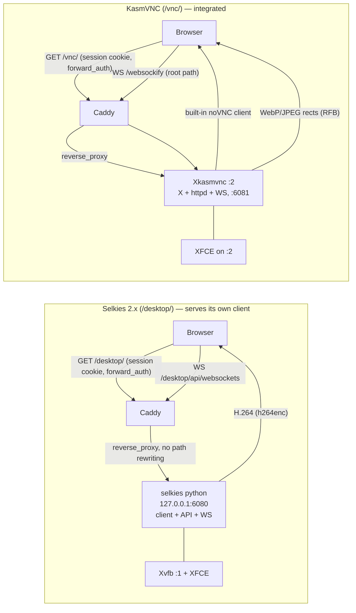

# Architecture

## Structure

Two top-level directories: `src/` holds everything that builds into the image (the Rust
workspace, the browser TypeScript, the `image/` recipe, the `tests/`); `deploy/` holds host-side
operation (setup/teardown scripts, systemd units, the standalone proxy `client/`, these `docs/`).
The runtime is Rust; the only TypeScript left is the browser upload page.

```
src/rust/                 The runtime — a Cargo workspace, hexagonal
├── core/   (sdw-core)    Pure rules + use cases, one folder per bounded context, no I/O:
│                         shared/ vault/ sync/ backup/ desktop/ egress/ workspace/ plugins/ transfer/
├── infra/  (sdw-infra)   Adapters for core's ports: gocryptfs, supervisorctl, Clash, restic,
│                         replication (git), notifications, shred, caddy, destruct-key, time, ...
├── cli/    (sdw, bin)    The multi-call binary: every container command + the `entrypoint` and the
│                         `backup-watcher` / `vault-sync` daemons. `sdw install` symlinks each command.
└── sync-service (lib)    The Axum sync API (/sync/api/*: upload / list / doctor / destruct); a
                          library folded into `sdw` and run as `sdw sync-service` (one binary).

src/packages/             The only TypeScript — the browser upload page
├── core/   (@sdw/core)   The sync CLIENT the browser needs: sync/{aad,client,envelope,protocol}
│                         (WebCrypto; also run by the host smoke fixture).
└── spa/    (@sdw/spa)    The browser UPLOAD page: a one-way encrypted push of a chosen local
                          folder into the vault (File System Access API + WebCrypto). NOT a
                          two-way sync — no download, delete or conflict handling. Vite-built,
                          served by Caddy under /sync/ (plus a /sync/#emergency destruct panel).
```

Hexagonal, unchanged by the Rust port: `core` holds the rules and use cases and depends on no
other crate; `infra` implements core's ports; `cli` and `sync-service` are the driving adapters.
Inside core the dependency points inward: `domain` <- `ports` <- `usecases`. Every core module
has mirrored tests, and `src/rust/sync-service/tests/parity.rs` pins the wire protocol to golden
vectors. The retired TS runtime (`src/packages/{server,cli,infra}` + the reimplemented core domain)
was replaced binary-for-binary; see deploy/docs/rust-migration.md.

`src/tests/architecture.test.ts` still guards the surviving TypeScript: core is a leaf, the SPA
depends only on core, and neither imports a node:/bun runtime (the browser invariants).

## Plugins

Optional features sit behind a deliberately tiny contract (`core/src/plugins`): a plugin
owns encrypted volumes. Everything that treats "all the volumes" alike (destroy, stale
mount cleanup at boot, `doctor`) iterates the registry (`plugins()`, `all_vaults()`) and
never names a plugin. The Rust code keeps this discipline; the automated R12 check that once
policed it retired with the TS `cli`/`infra` it scanned.

`pentest` is the only plugin. It is not built-in: sync and remote self-destruct are
built-in features, off unless `SYNC_ENABLED` / `REMOTE_DESTRUCT_ENABLED` is set.

To drop pentest: delete `src/rust/core/src/plugins/pentest/` and `src/rust/cli/src/commands/pentest_*`,
remove its entry from `plugins()` in `src/rust/core/src/plugins/mod.rs` and its commands from
`src/rust/cli/src/dispatch.rs`. Leftovers that do not
affect the build: `PENTEST_VAULT_PASSWORD` in `.env.example`, the `cache-data` volume in
`docker-compose.yml`, and `debootstrap` plus the `/pentest` directories in the
Dockerfile. The plugin is otherwise self-contained — nothing outside its own folders and the
registry names it — so removing it leaves no dangling reference elsewhere.

Commands are declared once, in `BIN_COMMANDS` in `src/rust/cli/src/dispatch.rs`; `sdw install`
symlinks each name to the multi-call binary (argv[0] dispatch, busybox style), replacing the
per-command launchers.

## Start-up

`sdw entrypoint` (`src/rust/cli/src/commands/entrypoint.rs`) is the composition root. The order of
the steps, what a failure of each one means, and which steps need the vault are data in
`src/rust/core/src/workspace/boot.rs` (`BOOT_PLAN`), tested without a container.

| Step | If it fails | Needs vault |
|------|-------------|-------------|
| preflight | abort | |
| prepare-run-dirs (root-only state, the ciphertext made 0700) | abort | |
| cleanup-stale-mounts | continue | |
| render-clash-config | continue | |
| git-globals, tune-inotify | continue | |
| enforce-egress (the nftables filter, on by default) | abort | |
| bring-up-egress | continue (reported) | |
| resolve-auth | abort | |
| init-vault, unlock-vault | continue (banner says LOCKED) | |
| prepare-replication (between the two) | continue | |
| notify-egress, prepare-desktops, prepare-backup | continue | yes |
| banner | continue | |
| supervisord | abort | |

"Continue" means the failure is recorded, shown in the banner, and the workspace starts
without that piece. What stops the boot is what would leave it in a state that is not what it
claims: a missing password or supervisord, root-only directories that cannot be made so, and an
egress firewall that is wanted (the default) but cannot be loaded, or an allowlist that does not
parse. `tune-inotify` only tries, then says what limit is in force (a container cannot raise it).

### Shutdown

`docker stop` sends SIGTERM to tini (PID 1), which passes it to `sdw entrypoint`; that hands it
to supervisord (via signal-hook), which stops every program in reverse start order and exits. The
container stops in about 4 seconds with exit code 0 (measured). Both self-destruct paths end in
the same SIGTERM to PID 1. (The old TS entrypoint died on the signal and let the kernel SIGKILL
whatever was still running; forwarding it was a fix carried into the Rust port.)

## Egress

Two layers, and they do different jobs (see `deploy/docs/threat-model.md`).

**The route.** Processes are pointed at Clash: `http_proxy`, `https_proxy`, `all_proxy`
(`socks5h`, so names are resolved by the proxy), `git`'s `http.proxy`, and an `ssh` client
configuration written at boot. Clash runs in rule mode with one rule to a group that starts with
`REJECT`, so a subscription without a usable node makes requests fail; it never makes them go
direct. The configuration is rendered at every start from a template that belongs to the image
(`/usr/share/sdw/clash/config.yaml.template`, outside the `clash-config` volume, which would
otherwise freeze the first version), with a controller secret that only root and the `clash` user
can read.

**The filter.** An nftables default-DROP OUTPUT chain (`core/src/egress/firewall.rs`) lets out
loopback, replies on established connections, the `clash` uid, and the networks of
`EGRESS_ALLOW_CIDRS`. It is on unless `EGRESS_ENFORCE` is a clear "no", it is loaded BEFORE Clash
starts, and the boot stops if it cannot be loaded. So the route is no longer a courtesy: a process
that ignores it is blocked, not leaked. `resolv.conf` points at Clash's DNS.

`src/rust/core/src/egress` also models what was observed: `confirmed`, `degraded` (proxy up, probe
through it failed) or `down` (proxy not listening). It is reported in the start-up banner,
`/var/run/egress-status`, `doctor` (live, with a row for the filter) and
`.notifications/egress-degraded.md`. `sdw clash-watcher` starts Clash again if it dies (only from a
config the renderer wrote) and `sdw egress-monitor` records changes in the audit trail.

The standalone client (`deploy/client`) is the same renderer and probe under `sdw proxy-only`,
built from the `clash-client` stage of `src/image/Dockerfile`.

## Privilege separation

Everything a user runs is the unprivileged user `dev`; the gate, the backup and sync jobs and
supervisord are root; Caddy and Clash have their own users. `sdw workload` is the launcher that
drops privileges and builds the allowlisted environment (`core/src/workspace/workload.rs`,
`infra/src/workload.rs`), and a `doas` bridge runs a generated list of `sdw` commands as root for
the few things that need it. The layout, what `dev` can and cannot reach, and the residual risks
are in `deploy/docs/threat-model.md`, "Privilege Separation"; `src/tests/smoke/checks/75-privilege.sh`
checks them against the running image.

## Runtime Stack

- **Rust** — the CLI, entrypoint, daemons (`sdw` multi-call binary) and the sync service, all
  static musl binaries; no language runtime ships in the image.
- **Axum / Tokio** — the sync service's HTTP server (`/sync/api/*`)
- **Caddy** — Reverse proxy (code-server + the sync-service API + the static SPA + dual desktops on single port)
- **KasmVNC (default) / Selkies (optional)** — Browser-accessible remote desktop; the image holds one or both, chosen at build time. See "Remote Desktop: Selkies vs KasmVNC" below.
- **Clash/mihomo** — Encrypted egress proxy (proxy-providers + url-test auto-selection, 1h subscription refresh, 3min health-check)
- **gocryptfs** — Disk encryption (AES-256, 4KB blocks)
- **restic** — Realtime backup to S3 (client-side encryption, dedup, snapshots; opt-in via `RESTIC_REPOSITORY`)
- **supervisord** — Process management
- **Zulu JDK 17** — Java runtime (via mise)

## Security Layers

```
L6: E2E encryption (WebCrypto AES-256-GCM)       ← Sync file transfer
L5: gocryptfs (AES-256)                           ← Disk encryption at rest
L4: Unified auth gateway — deny-by-default        ← Perimeter: ONE session-cookie / Cloudflare
    (Caddy forward_auth -> sync-service)             Access-JWT check in front of every route, HTTP + WS
L3: Privilege separation (dev user, doas bridge)   ← Code in the workspace holds no secret and no capability
L2: Cloudflare Tunnel (TLS) [+ Access at edge]    ← Network encryption + optional edge zero-trust
L1: Clash proxy + nftables default-DROP            ← Traffic obfuscation; nothing leaves except through it
```

The gate (`deploy/docs/design-unified-auth-gateway.md`) terminates authentication once at the
ingress: a signed session cookie (login with the master password) OR, when behind Access, the
`Cf-Access-Jwt-Assertion` the edge injects (RS256-verified against the team JWKS). The cookie
rides the WebSocket upgrade, so code-server, KasmVNC `/websockify` and Selkies `/desktop/api/websockets`
are all covered by the same check; only `/auth/*` and the break-glass `/sync/api/destruct` are
un-gated. The backends have no password of their own (code-server `--auth none`, KasmVNC
`-DisableBasicAuth`, Selkies' own Basic auth switched off): one login, and no copy of the master
password where the workload could read it. A WebSocket handshake from another site's `Origin` is refused even with a valid cookie.

## Data Flow

```
Browser → Cloudflare Tunnel [+ Access] → Caddy(:8080)
        → auth gate (forward_auth → sync-service /auth/verify; deny-by-default)
        → code-server(:8082) / sync-service(:8081) / desktops
Workspace egress → Clash(:7890) → Proxy nodes → Internet   (nothing else leaves: see Egress)
Vault sync → git push (via Clash) → GitHub (encrypted ciphertext)
Realtime backup → restic (via Clash) → S3 (restic-encrypted, deduplicated snapshots)
```

## Key Design Decisions

1. Single container (FUSE mount shared across all services)
2. Egress through Clash only: proxy variables for the route, an nftables default-DROP filter for the guarantee (on by default; `EGRESS_ENFORCE=0` to lift it); the result is observed and reported
3. No plaintext on disk (gocryptfs FUSE only in memory)
4. PNG camouflage on sync wire (DLP evasion)
5. Replay protection (ring buffer nonce tracking)
6. LaunchAgent for tunnel (no sudo, auto-start on login)
7. Dual persistence: vault-sync (git, 30min cron, ciphertext) + restic (S3, event-driven 10s, plaintext→restic-encrypted)

## Persistence Model

Two independent backup chains coexist:

| Chain | Source | Trigger | Backend | Encryption | Purpose |
|-------|--------|---------|---------|------------|---------|
| vault-sync | `/vault/cipher` (gocryptfs ciphertext) | cron (30 min) | GitHub (git push) | gocryptfs (at-rest) | Slow secondary off-site |
| backup-watcher | `/workspace` (plaintext FUSE) | inotify + 10s debounce | S3 (restic) | restic client-side | Fast primary backup |

Both are opt-in (`VAULT_GIT_REPO` / `RESTIC_REPOSITORY`). Neither blocks the other.
The backup-watcher holds inotify watches on `/workspace` and must be stopped before
`fusermount -u` (handled by `lock-vault` and `destroy`).

## Releasing the vault

`lock-vault`, `lock-pentest` and self-destruct all go through `unmount_vault`
(`src/rust/infra/src/gocryptfs.rs`): stop the holders we know about (desktops, the backup watcher),
then `fusermount -u`. The escalating mode (`lock-pentest`, self-destruct) then kills whatever
still uses the mount and retries, and finally detaches it lazily. `fuser` (from `psmisc`) finds
fd holders; a second pass reads `/proc/net/unix` to catch a process that only holds a bound
socket under the mount, which `fuser` cannot see. Two rules, both found by running self-destruct
from a terminal inside the container:

- the calling process steps out of the mount first. A process standing in it blocks the
  unmount, and after a lazy detach `getcwd` fails, so every later subprocess dies with ENOENT
  (the keys were never erased);
- the kill step never touches the caller or any of its ancestors (`lineage` / `killable` in
  `src/rust/core/src/vault/domain.rs`). Killing its shell hangs up the terminal and takes the caller
  down with it.

## Host services

The host side (Cloudflare Tunnel, `host-watcher`) runs as a LaunchAgent on macOS and as
systemd user units on Linux (`deploy/linux-systemd/`). When the container reports a completed
self-destruct, the watcher runs `destroy.sh --force --paranoid --delete-project`, which removes those very
services. The service manager kills everything a removed service started, so the cleanup runs
outside the watcher's service (`run_outside_service` in `deploy/scripts/host-watcher.sh`: a new
session on macOS, a transient `systemd-run --user` unit on Linux). Run as its child it was cut
off at the first line that removed the service, on both platforms.

## Remote Desktop: Selkies vs KasmVNC

The image contains one or both desktops, chosen at build time with `DESKTOP_STACK`
(default `kasmvnc`; `selkies` and `both` are supported, and CI publishes `both` as the
`-full` image). When both are installed they run in parallel, each on an independent X
display, WS port, and HOME, behind one Caddy port:

- **Selkies** → `/desktop/` — display `:1`, WS `:6080`, HOME `/workspace/.desktop`
- **KasmVNC** → `/vnc/` — display `:2`, WS `:6081`, HOME `/workspace/.desktop-vnc`

### Request flow



Architectural difference: Selkies separates the X server from the streamer (Xvfb + a
Python server that also serves the web client and a small API on one port, under the
path prefix `/desktop`); KasmVNC bundles X server, encoder and client in one `Xkasmvnc`
binary. Both are plain reverse-proxied routes behind the one session gate.

Selkies 2.x is installed from its release wheel (`src/image/tools/selkies.env`, sha256
checked by `fetch-tool`) and a hash-locked dependency file (`selkies-requirements.txt`,
installed with `pip --require-hashes --only-binary`). The 1.x line this image used to
pin was deleted from PyPI and GitHub by its authors in November 2026, which stopped the
`-full` image from building at all until it moved. `deploy/scripts/update-tools.sh`
edits the pin and the lock together. What is switched off, and why, is in
`src/image/etc/desktop/start-selkies.sh` (Selkies' own Basic auth, the WebRTC transport,
sharing links, printing, the applications panel).

### Measured facts (this image, Kali arm64 / Colima, Selkies 2.2.0, 2026-11-04)

All numbers below were measured directly in the same running container. Both desktops
were **idle** (no client connected, right after the browser check had connected and left)
when RSS was sampled. (The earlier version of this table was measured with Selkies 1.x
and is replaced, not extended.)

| Metric | Selkies | KasmVNC | How measured |
|--------|---------|---------|--------------|
| Idle RSS (stream server) | selkies(python) ~140 MB + Xvfb ~135 MB | Xkasmvnc ~145 MB | `ps -o rss` |
| Install footprint | Python environment 162 MB | .deb files 7.8 MB | `du -sh` / `dpkg -L` |
| Web client | 10 MB (inside the wheel) | 3.4 MB | `du -sh` |
| Browser decode API | `VideoDecoder` (WebCodecs) | WebAssembly + Canvas2D (`drawImage`/`putImageData`) | grep shipped JS |
| Encoder (configured) | h264enc (x264), 30 fps | WebP/JPEG rects, 30 fps | start-selkies.sh, desktop-vnc.conf |
| Auth | the ingress session cookie only (its own Basic auth is switched off) | the ingress session cookie only (`-DisableBasicAuth`) | start-selkies.sh, `20-auth.sh` |

Build-layer cost: the Selkies layer (apt libraries, the wheel, 30 hash-checked
dependencies) took 231 s on the Aliyun mirror; the KasmVNC `.deb` layer is
comparatively small. Selkies' Python environment (162 MB) is still the largest desktop cost.

### NOT measured (do not treat as fact)

The following are commonly-cited differences but were **not** benchmarked in this
environment. They are listed only as directions to test if it matters:

- **localhost latency**: on loopback the network RTT is ~0 for both; the
  bottleneck is the encode/decode path, not the link. We did **not** run a
  controlled latency/FPS benchmark, so treat Selkies and KasmVNC as
  **comparable on localhost** until measured. Do not claim one is dramatically
  faster locally.
- **High-RTT / tunnel behavior, bandwidth under motion, CPU under load**: not
  benchmarked here. H.264 (Selkies) vs adaptive WebP rects (KasmVNC) have
  different theoretical trade-offs, but no numbers were collected.

### Qualitative, verifiable differences

These are structural facts (verifiable from config/code), not performance claims:

- **Browser compatibility**: Selkies requires the WebCodecs `VideoDecoder` API
  (Chromium 94+, Safari 16.4+); KasmVNC decodes via WebAssembly + Canvas2D, so it
  works on older browsers lacking WebCodecs.
- **Auth UX**: both sit behind the one ingress login (session cookie, which also rides
  the WebSocket handshake) and neither asks for anything more.
- **Features**: KasmVNC's client ships multi-monitor, DLP and a settings panel;
  Selkies' client has a side panel (video, screen and audio settings, clipboard, a
  file manager for uploads and downloads) and desktop **audio** (pcmflux, with
  `DESKTOP_AUDIO=1`), which KasmVNC does not.
- **Dependency fragility**: Selkies is a Python server with native libraries
  (pixelflux, pcmflux) that need a recent libva (hence the trixie/Kali base). Its
  maintainers removed the whole 1.x line from PyPI and GitHub in November 2026, so a
  pin that was reproducible one week stopped building the next; the pin is now the
  release wheel plus a hash-locked dependency file, kept by `update-tools.sh`.
  KasmVNC's `.deb` is comparatively self-contained.

### Recommendation

The default is `kasmvnc`: a 7.8 MB package against Selkies' 162 MB Python environment,
and it works on browsers without WebCodecs. Selkies stays fully supported for its
audio and H.264 stream: build with `DESKTOP_STACK=selkies` or `both`, or pull the
`-full` image. CI builds `both` on every release so the Selkies path cannot rot.
An image that predates the stack marker is treated as Selkies-only.
