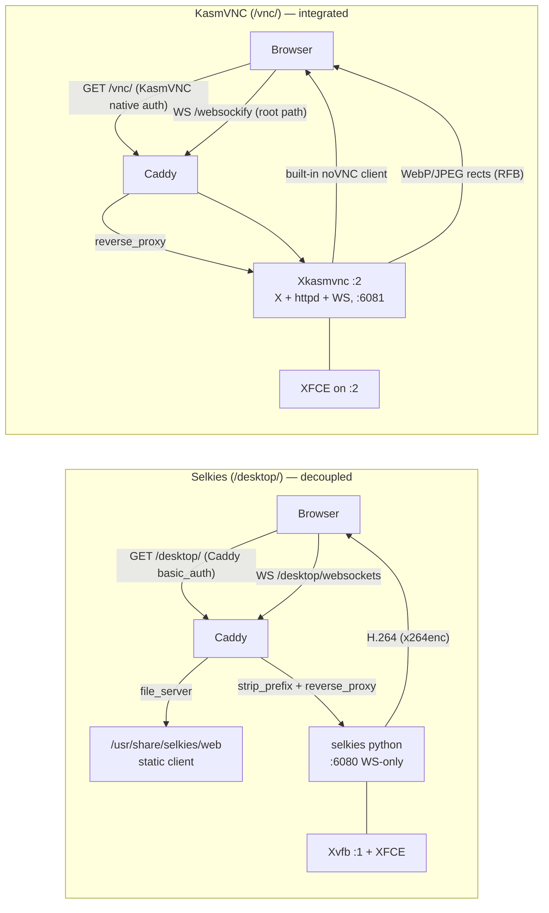

# Architecture

## Monorepo Structure

Hexagonal: `core` holds the rules and use cases, `infra` implements core's ports, and
`cli` / `server` / `spa` are driving adapters that wire them together.

```
packages/
├── core/    Pure rules + use cases, one folder per bounded context. No node:/bun imports.
│            shared/ vault/ sync/ backup/ desktop/ egress/ workspace/ plugins/
├── infra/   Adapters for core's ports: gocryptfs, supervisorctl, Clash, restic helpers,
│            sync crypto/store, notifications, shred, ...
├── cli/     Container commands (init-vault, unlock-vault, doctor, ...), entrypoint-main,
│            and plugins/<id>/commands for each plugin's own commands
├── server/  Hono sync service: thin routes over core's sync use cases
└── spa/     Browser sync page (File System Access API + WebCrypto), shares core's client
```

The dependency rules are executable, not aspirational: `tests/architecture.test.ts`
(ratchet, R1-R10) fails the build on a new violation. In short: core imports no other
package and no runtime; infra depends only on core; server and cli never import each
other; `process.env` is read only in entry points (`loadConfig`); absolute paths live
only in each context's `layout.ts`.

Inside core the dependency points inward: `domain` <- `ports` <- `usecases`.

## Plugins

Optional features sit behind a deliberately tiny contract (`core/src/plugins`): a plugin
owns encrypted volumes. Everything that treats "all the volumes" alike (destroy, stale
mount cleanup at boot, `doctor`) iterates the registry (`PLUGINS`, `ALL_VAULTS`) and
never names a plugin. Rule R12 in `tests/architecture.test.ts` enforces that: nothing
outside a plugin's own folders (and the registry line) may mention its name.

`pentest` is the only plugin. It is not built-in: sync and remote self-destruct are
built-in features, off unless `SYNC_ENABLED` / `REMOTE_DESTRUCT_ENABLED` is set.

To drop pentest: delete `core/src/plugins/pentest/`, `cli/src/plugins/pentest/` and
`core/tests/plugins/pentest.test.ts`, remove its line from `core/src/plugins/index.ts`,
and its five entries from the `bin` map in `cli/package.json`. Leftovers that do not
affect the build: `PENTEST_VAULT_PASSWORD` in `.env.example`, the `cache-data` volume in
`docker-compose.yml`, and `debootstrap` plus the `/pentest` directories in the
Dockerfile. A drill in a throwaway copy (two files edited, two directories deleted)
passed biome, the type check, the full test suite and bundling of every entry point,
with no mention of pentest left under `packages/`.

Commands are declared once, in `cli/package.json`'s `bin` map; the image build installs
a launcher for each (`cli/scripts/install-bins.ts`), and a test fails when an entry file
is neither declared there nor a known service.

## Start-up

`cli/src/entrypoint-main.ts` is a composition root. The order of the steps, what a
failure of each one means, and which steps need the vault are data in
`core/workspace/boot.ts` (`BOOT_PLAN`), tested without a container.

| Step | If it fails | Needs vault |
|------|-------------|-------------|
| preflight | abort | |
| cleanup-stale-mounts | continue | |
| render-clash-config | continue | |
| git-globals, tune-inotify | continue | |
| bring-up-egress | continue (reported) | |
| resolve-auth | abort | |
| init-vault, unlock-vault | continue (banner says LOCKED) | |
| prepare-replication (between the two) | continue | |
| notify-egress, prepare-desktops, prepare-backup | continue | yes |
| banner | continue | |
| supervisord | abort | |

"Continue" means the failure is recorded, shown in the banner, and the workspace starts
without that piece. Only a missing password or a missing supervisord stops the boot.

### Shutdown

`docker stop` sends SIGTERM to tini (PID 1), which passes it to `entrypoint-main.ts`; that
hands it to supervisord, which stops every program in reverse start order and exits. The
container stops in about 4 seconds with exit code 0 (measured). Both self-destruct paths end
in the same SIGTERM to PID 1. Before this was wired up, Bun died on the signal and the kernel
SIGKILLed whatever was still running.

## Egress

Routing through Clash is **best effort, not enforced** (see `docs/threat-model.md`).
`core/egress` models what was observed: `confirmed`, `degraded` (proxy up, probe through
it failed) or `down` (proxy not listening). It is reported in the start-up banner,
`/var/run/egress-status`, `doctor` (live) and `.notifications/egress-degraded.md`.

## Runtime Stack

- **Bun** — TypeScript runtime (replaces Node.js)
- **Hono** — HTTP framework (12,640 req/s)
- **Caddy** — Reverse proxy (code-server + sync-service + dual desktops on single port)
- **KasmVNC (default) / Selkies (optional)** — Browser-accessible remote desktop; the image holds one or both, chosen at build time. See "Remote Desktop: Selkies vs KasmVNC" below.
- **Clash/mihomo** — Encrypted egress proxy (proxy-providers + url-test auto-selection, 1h subscription refresh, 3min health-check)
- **gocryptfs** — Disk encryption (AES-256, 4KB blocks)
- **restic** — Realtime backup to S3 (client-side encryption, dedup, snapshots; opt-in via `RESTIC_REPOSITORY`)
- **supervisord** — Process management
- **Zulu JDK 17** — Java runtime (via mise)

## Security Layers

```
L5: E2E encryption (WebCrypto AES-256-GCM)     ← Sync file transfer
L4: code-server password                        ← Access control
L3: Cloudflare Tunnel (TLS)                     ← Network encryption
L2: gocryptfs (AES-256)                         ← Disk encryption
L1: Clash proxy (VLESS+WS+TLS)                  ← Traffic obfuscation
```

## Data Flow

```
Browser → Cloudflare Tunnel → Caddy(:8080) → code-server(:8082) / sync-service(:8081)
Proxy-aware egress → Clash(:7890) → Proxy nodes → Internet   (not enforced: see Egress)
Vault sync → git push (via Clash) → GitHub (encrypted ciphertext)
Realtime backup → restic (via Clash) → S3 (restic-encrypted, deduplicated snapshots)
```

## Key Design Decisions

1. Single container (FUSE mount shared across all services)
2. Best-effort egress through Clash (proxy environment variables); observed and reported, not enforced
3. No plaintext on disk (gocryptfs FUSE only in memory)
4. PNG camouflage on sync wire (DLP evasion)
5. Replay protection (ring buffer nonce tracking)
6. LaunchAgent for tunnel (no sudo, auto-start on login)
7. Dual persistence: vault-sync (git, 30min cron, ciphertext) + restic (S3, event-driven 10s, plaintext→restic-encrypted)

## Persistence Model

Two independent backup chains coexist:

| Chain | Source | Trigger | Backend | Encryption | Purpose |
|-------|--------|---------|---------|------------|---------|
| vault-sync | `/vault/cipher` (gocryptfs ciphertext) | cron (30 min) | GitHub (git push) | gocryptfs (at-rest) | Slow secondary off-site |
| backup-watcher | `/workspace` (plaintext FUSE) | inotify + 10s debounce | S3 (restic) | restic client-side | Fast primary backup |

Both are opt-in (`VAULT_GIT_REPO` / `RESTIC_REPOSITORY`). Neither blocks the other.
The backup-watcher holds inotify watches on `/workspace` and must be stopped before
`fusermount -u` (handled by `lock-vault` and `destroy`).

## Releasing the vault

`lock-vault`, `lock-pentest` and self-destruct all go through `unmountVault`
(`infra/gocryptfs.ts`): stop the holders we know about (desktops, the backup watcher), then
`fusermount -u`. The escalating mode (`lock-pentest`, self-destruct) then kills whatever
still uses the mount and retries, and finally detaches it lazily. `fuser` comes from `psmisc`
in the image. Two rules, both found by running self-destruct from a terminal inside the
container:

- the calling process steps out of the mount first. A process standing in it blocks the
  unmount, and after a lazy detach `getcwd` fails, so every later subprocess dies with ENOENT
  (the keys were never erased);
- the kill step never touches the caller or any of its ancestors (`lineage` / `killable` in
  `core/vault/domain.ts`). Killing its shell hangs up the terminal and takes the caller down
  with it.

## Host services

The host side (Cloudflare Tunnel, `host-watcher`) runs as a LaunchAgent on macOS and as
systemd user units on Linux (`deploy/linux-systemd/`). When the container reports a completed
self-destruct, the watcher runs `destroy.sh --force --paranoid`, which removes those very
services. The service manager kills everything a removed service started, so the cleanup runs
outside the watcher's service (`run_outside_service` in `scripts/host-watcher.sh`: a new
session on macOS, a transient `systemd-run --user` unit on Linux). Run as its child it was cut
off at the first line that removed the service, on both platforms.

## Remote Desktop: Selkies vs KasmVNC

The image contains one or both desktops, chosen at build time with `DESKTOP_STACK`
(default `kasmvnc`; `selkies` and `both` are supported, and CI publishes `both` as the
`-full` image). When both are installed they run in parallel, each on an independent X
display, WS port, and HOME, behind one Caddy port:

- **Selkies** → `/desktop/` — display `:1`, WS `:6080`, HOME `/workspace/.desktop`
- **KasmVNC** → `/vnc/` — display `:2`, WS `:6081`, HOME `/workspace/.desktop-vnc`

### Request flow



Architectural difference: Selkies decouples X server / encoder / static client
(Xvfb + python + Caddy `file_server`); KasmVNC bundles all three in one
`Xkasmvnc` binary. This drives the auth-model difference below.

### Measured facts (this image, Kali arm64 / Docker Desktop, 2026-06-01)

All numbers below were measured directly in the running container. Both desktops
were **idle** (no client connected) when RSS was sampled.

| Metric | Selkies | KasmVNC | How measured |
|--------|---------|---------|--------------|
| Idle RSS (stream server) | selkies(python) ~67 MB + Xvfb ~110 MB | Xkasmvnc ~122 MB | `ps -o rss` |
| X-server binary | Xvfb 2.1 MB | Xkasmvnc 4.0 MB | `ls -lh` |
| Install footprint | venv 420 MB | .deb files 7.8 MB | `du -sh` / `dpkg -L` |
| Static web client | 5.9 MB | 3.4 MB | `du -sh` |
| Browser decode API | `VideoDecoder` (WebCodecs) | WebAssembly + Canvas2D (`drawImage`/`putImageData`) | grep shipped JS |
| Encoder (configured) | x264enc, 30 fps | WebP/JPEG rects, 30 fps | supervisor conf |
| Auth realm | Caddy `restricted` (shared with code-server) | KasmVNC native `Websockify` | `WWW-Authenticate` header |

Build-layer cost observed during this session's Kali build: the selkies pip/venv
layer dominates (~12 min on the throttled mirror); the KasmVNC `.deb` layer is
comparatively small. Selkies' venv (420 MB) is the single largest desktop cost.

### NOT measured (do not treat as fact)

The following are commonly-cited differences but were **not** benchmarked in this
environment. They are listed only as directions to test if it matters:

- **localhost latency**: on loopback the network RTT is ~0 for both; the
  bottleneck is the encode/decode path, not the link. We did **not** run a
  controlled latency/FPS benchmark, so treat Selkies and KasmVNC as
  **comparable on localhost** until measured. Do not claim one is dramatically
  faster locally.
- **High-RTT / tunnel behavior, bandwidth under motion, CPU under load**: not
  benchmarked here. H.264 (Selkies) vs adaptive WebP rects (KasmVNC) have
  different theoretical trade-offs, but no numbers were collected.

### Qualitative, verifiable differences

These are structural facts (verifiable from config/code), not performance claims:

- **Browser compatibility**: Selkies requires the WebCodecs `VideoDecoder` API
  (Chromium 94+, Safari 16.4+); KasmVNC decodes via WebAssembly + Canvas2D, so it
  works on older browsers lacking WebCodecs.
- **Auth UX**: Selkies shares Caddy's `restricted` realm with code-server (one
  credential cache, no extra prompt). KasmVNC owns its own `Websockify` realm
  (browsers won't replay Caddy creds to the VNC WebSocket), so it prompts once
  more with the same username/password.
- **Features**: KasmVNC's client ships multi-monitor, file upload/download, DLP,
  and a settings panel; Selkies' client is a minimal full-screen stream and adds
  desktop **audio** (pcmflux) which KasmVNC does not.
- **Dependency fragility**: Selkies needs libva ≥2.20 (hence the trixie/Kali
  base requirement); KasmVNC's `.deb` is comparatively self-contained.

### Recommendation

The default is `kasmvnc`: a 7.8 MB package against Selkies' 420 MB venv and ~12 minute
build layer, and it works on browsers without WebCodecs. Selkies stays fully supported
for its audio and H.264 stream: build with `DESKTOP_STACK=selkies` or `both`, or pull
the `-full` image. CI builds `both` on every release so the Selkies path cannot rot.
An image that predates the stack marker is treated as Selkies-only.
